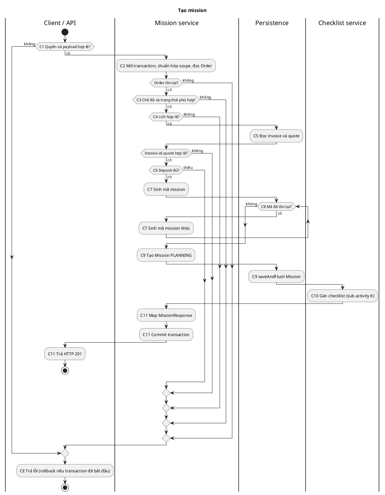
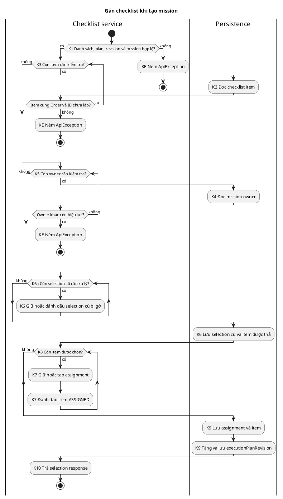
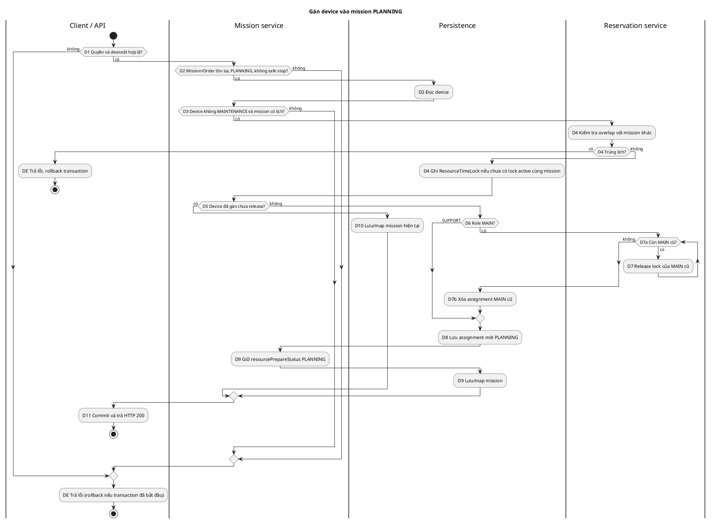
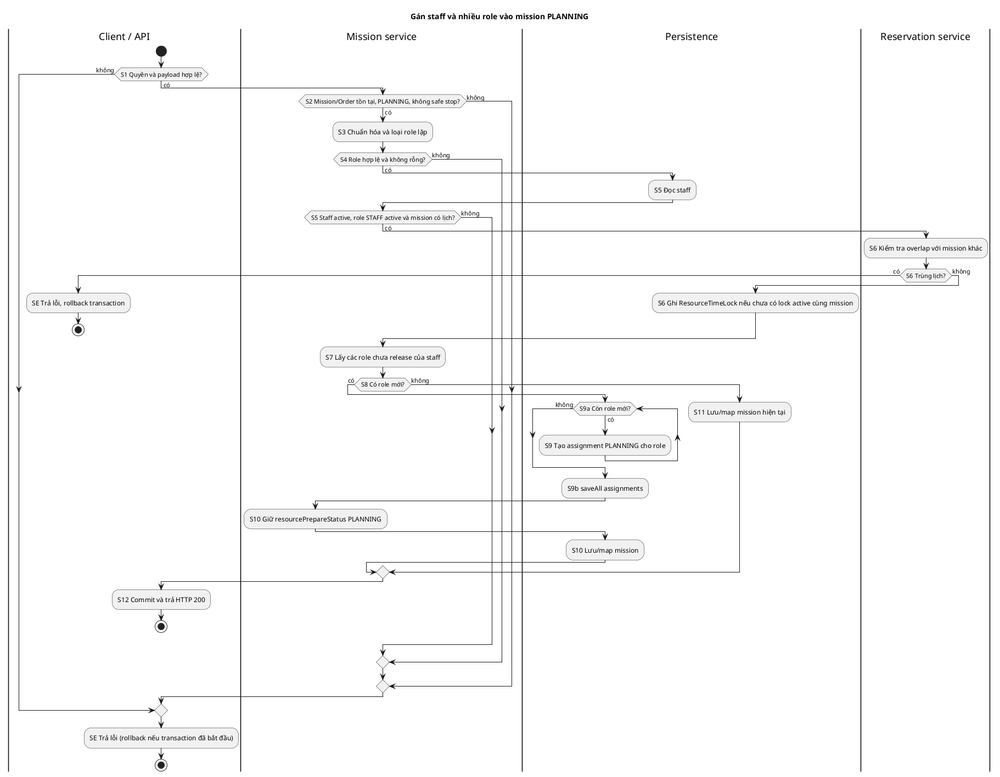

# Activity Diagram: tạo mission và phân bổ resource

Tài liệu này mô tả code hiện tại. PlantUML là biểu diễn văn bản để dựng lại Activity Diagram trong Visual Paradigm, không phải project Visual Paradigm gốc. Các sơ đồ tách theo từng HTTP request: tạo mission, gán device, gán staff. Bước gán checklist khi tạo mission là một sub-activity riêng.

## A. Workflow summary

| Luồng | Entry point, actor | Đường thành công | Nhánh chính và thay đổi dữ liệu |
|---|---|---|---|
| Tạo mission | `POST /api/missions/{orderId}` → `MissionController.createMission`; MANAGER/ADMIN | Xác thực payload và quyền → đọc Order → kiểm tra kế hoạch DRAFT, lịch, invoice và deposit → sinh mã chưa trùng → lưu Mission PLANNING → gán checklist → trả 201 | Tạo `Mission`; tạo `MissionChecklistAssignment`, đổi `OrderChecklistItem.assignmentStatus` thành ASSIGNED và tăng `Order.executionPlanRevision`. Không tạo checklist execution và không gán resource. Nếu bước gán checklist lỗi, transaction tạo mission rollback. |
| Tạo thêm mission | `POST /api/missions/{orderId}/additional` → `createAdditional`; MANAGER/ADMIN | Cùng luồng tạo, nhưng kiểm tra kế hoạch FINALIZED và Order APPROVED/IN_PROGRESS | Mission mới vẫn PLANNING; checklist được gán theo cùng sub-activity. |
| Gán device | `POST /api/missions/{id}/device-assignments` → `assignDevice`; MANAGER/ADMIN | Mission PLANNING → device tồn tại, không MAINTENANCE → đặt `ResourceTimeLock` → lưu `MissionDeviceAssignment` | Nếu cùng device đã gán và chưa release: trả mission hiện tại. Nếu gán MAIN mới: release lock của MAIN cũ, xóa các assignment MAIN cũ rồi lưu assignment mới. Assignment mới có `isCurrent=false`, `checkupStatus=PLANNING`; mission vẫn PLANNING. |
| Gán staff | `POST /api/missions/{id}/staff-assignments` → `assignStaff`; MANAGER/ADMIN | Mission PLANNING → danh sách role hợp lệ → staff đang hoạt động → đặt `ResourceTimeLock` → chỉ tạo các role chưa có | Một staff có thể giữ nhiều role. Role trùng trong payload bị loại; role đã gán và chưa release không được tạo lại. Assignment mới có `isCurrent=false`, `responseStatus=PLANNING`; mission vẫn PLANNING. |

Mỗi API là một request/transaction độc lập. Client phải gọi API tạo mission trước, rồi gọi gán device/staff với ID mission đã tạo. Không có vòng lặp tự động từ API tạo sang hai API phân bổ.

Quyền được kiểm tra ở controller và service. `MissionAuthorizationServiceImpl.canManageMissions` yêu cầu tài khoản active và role MANAGER hoặc ADMIN đang active. `@Valid` trả lỗi validation trước khi gọi service. `ApiException` được `GlobalExceptionHandler` chuyển thành HTTP status/code tương ứng. Lỗi runtime trong transaction dẫn tới rollback theo Spring; các `saveAndFlush` không phải commit. Không có external API, message broker hoặc fork/join trong các luồng này.

Lưu ý theo code: tạo mission thường chỉ kiểm tra `ExecutionPlanStatus.DRAFT`, không kiểm tra `OrderStatus.APPROVED`; tạo thêm mission có kiểm tra `OrderStatus`. `assignDevice` không chặn mọi `DeviceStatus` khác MAINTENANCE. Hai API gán gọi `reserve` để kiểm tra và lưu lock; không gọi `lockResources`/mutex trong đường này. Lịch staff không được kiểm tra qua `UserSchedule` ở `assignStaff`; xung đột dựa trên `ResourceTimeLock`.

## B. Activity diagram specification

### Swimlanes

| Partition | Responsibility | Related components |
|---|---|---|
| Client/API | Gửi request, kiểm tra quyền và DTO, trả HTTP | `MissionController`, Spring Security, `GlobalExceptionHandler` |
| Mission service | Điều phối nghiệp vụ, transaction và state | `MissionService`, `MissionRuntimeGate`, `MissionPaymentEligibilityService` |
| Checklist service | Kiểm tra ownership, cập nhật selection/revision | `MissionChecklistAssignmentServiceImpl` |
| Reservation service | Kiểm tra trùng lịch, ghi/release time lock | `ResourceReservationServiceImpl` |
| Persistence | Đọc/ghi entity; constraint DB | Spring Data repositories, PostgreSQL |

### Nodes: tạo mission

| ID | UML element | Label | Swimlane | Source reference |
|---|---|---|---|---|
| C0 | Initial | Bắt đầu request tạo mission | Client/API | `MissionController.java:68-82` |
| C1 | Decision | Quyền và payload hợp lệ? | Client/API | `MissionController.java:68-82`; `MissionCreateRequest.java` |
| C2 | Action | Mở transaction, chuẩn hóa scope, yêu cầu đọc Order | Mission service | `MissionService.java:344-362` |
| C3 | Decision | Chế độ tạo và trạng thái plan/Order phù hợp? | Mission service | `MissionService.java:363-370` |
| C4 | Decision | Lịch trong một ngày và trong khoảng khách chọn? | Mission service | `MissionService.java:371,572-615` |
| C5 | Decision | Có invoice với quote được chấp nhận? | Mission service | `MissionService.java:373-376` |
| C6 | Decision | Deposit đã đủ? | Mission service | `MissionService.java:377-380` |
| C7 | Action | Sinh mã mission ngẫu nhiên | Mission service | `MissionService.java:1706-1712` |
| C8 | Decision | Mã mission đã tồn tại? | Persistence | `MissionService.java:1711` |
| C9 | Action | Tạo và yêu cầu lưu Mission với status PLANNING và lịch/scope | Mission service | `MissionService.java:381-387` |
| C10 | Action / call behavior | Gán checklist cho mission | Checklist service | `MissionService.java:388,561-570`; sub-activity K |
| C11 | Action | Map MissionResponse, commit, trả 201 | Client/API | `MissionService.java:390`; `MissionController.java:73-82` |
| CE | Action | Trả lỗi; rollback nếu đã mở transaction | Client/API | `GlobalExceptionHandler.java:77-88,119-136`; `@Transactional` |
| CF | Activity final | Kết thúc request | Client/API | Entry point |

### Flows: tạo mission

| From | To | Flow type | Guard condition |
|---|---|---|---|
| C0 | C1 | Control | — |
| C1 | C2 | Control | `[quyền và DTO hợp lệ]` |
| C1 | CE | Control | `[không có quyền hoặc DTO lỗi]` |
| C2 | C3 | Control | `[Order tồn tại]` |
| C2 | CE | Control | `[Order không tồn tại]` |
| C3 | C4 | Control | `[thường: DRAFT; thêm: FINALIZED và Order APPROVED/IN_PROGRESS]` |
| C3 | CE | Control | `[điều kiện còn lại]` |
| C4 | C5 | Control | `[lịch hợp lệ]` |
| C4 | CE | Control | `[lịch không hợp lệ]` |
| C5 | C6 | Control | `[invoice/quote hợp lệ]` |
| C5 | CE | Control | `[không hợp lệ]` |
| C6 | C7 | Control | `[deposit đủ]` |
| C6 | CE | Control | `[deposit thiếu]` |
| C7 | C8 | Control | — |
| C8 | C7 | Control/back edge | `[mã trùng]` |
| C8 | C9 | Control | `[mã chưa tồn tại]` |
| C9 | C10 | Control | `[ghi thành công]` |
| C9 | CE | Exception | `[ghi lỗi]` |
| C10 | C11 | Control | `[gán checklist thành công]` |
| C10 | CE | Exception | `[gán checklist lỗi]` |
| C11 | CF | Control | — |
| CE | CF | Control | — |

### Nodes: sub-activity gán checklist khi tạo

| ID | UML element | Label | Swimlane | Source reference |
|---|---|---|---|---|
| K0 | Initial | Nhận mission và checklistIds | Checklist service | `MissionService.java:561-569` |
| K1 | Decision | Danh sách không rỗng, plan/revision/mission hợp lệ? | Checklist service | `MissionService.java:562-563`; `MissionChecklistAssignmentServiceImpl.java:41-56` |
| K2 | Action | Đọc và kiểm tra checklist item cùng Order, không lặp ID | Persistence | `MissionChecklistAssignmentServiceImpl.java:58-64` |
| K3 | Decision | Còn item cần kiểm tra? | Checklist service | `MissionChecklistAssignmentServiceImpl.java:58-64` |
| K4 | Action | Đọc owner khác và kiểm tra mission owner còn hiệu lực | Persistence | `MissionChecklistAssignmentServiceImpl.java:65-75` |
| K5 | Decision | Còn owner cần kiểm tra? | Checklist service | `MissionChecklistAssignmentServiceImpl.java:67-75` |
| K6 | Action | Đánh dấu selection cũ bị gỡ, lưu thay đổi | Checklist service | `MissionChecklistAssignmentServiceImpl.java:76-91` |
| K6a | Decision | Còn selection cũ cần xử lý? | Checklist service | `MissionChecklistAssignmentServiceImpl.java:81-89` |
| K7 | Action | Tạo/giữ assignment, đánh dấu item ASSIGNED | Checklist service | `MissionChecklistAssignmentServiceImpl.java:94-104` |
| K8 | Decision | Còn item được chọn? | Checklist service | `MissionChecklistAssignmentServiceImpl.java:94-104` |
| K9 | Action | Lưu assignment/item, tăng và lưu plan revision | Persistence | `MissionChecklistAssignmentServiceImpl.java:105-108` |
| K10 | Action | Trả selection response cho luồng tạo | Checklist service | `MissionChecklistAssignmentServiceImpl.java:109,113-116` |
| KF | Activity final | Kết thúc sub-activity | Checklist service | `MissionChecklistAssignmentServiceImpl.java:109` |
| KE | Activity final | Ném ApiException; transaction cha rollback | Checklist service | `MissionChecklistAssignmentServiceImpl.java:41-108` |

### Flows: sub-activity checklist

| From | To | Flow type | Guard condition |
|---|---|---|---|
| K0 | K1 | Control | — |
| K1 | K3 | Control | `[hợp lệ]` |
| K1 | KE | Control | `[không hợp lệ]` |
| K3 | K2 | Control | `[còn item]` |
| K2 | K3 | Control/back edge | `[item hợp lệ]` |
| K2 | KE | Exception | `[item thiếu/sai Order/trùng]` |
| K3 | K5 | Control | `[hết item]` |
| K5 | K4 | Control | `[còn owner]` |
| K4 | K5 | Control/back edge | `[không có owner hiệu lực khác]` |
| K4 | KE | Exception | `[owner hiệu lực khác]` |
| K5 | K6a | Control | `[hết owner]` |
| K6a | K6 | Control | `[còn selection cũ]` |
| K6 | K6a | Control/back edge | `[xử lý xong selection]` |
| K6a | K8 | Control | `[hết selection cũ, lưu thành công]` |
| K6 | KE | Exception | `[integrity/ghi lỗi]` |
| K8 | K7 | Control | `[còn item]` |
| K7 | K8 | Control/back edge | `[xử lý xong item]` |
| K8 | K9 | Control | `[hết item]` |
| K9 | K10 | Control | `[ghi thành công]` |
| K9 | KE | Exception | `[ghi lỗi]` |
| K10 | KF | Control | — |

### Nodes: gán device

| ID | UML element | Label | Swimlane | Source reference |
|---|---|---|---|---|
| D0 | Initial | Nhận request gán device | Client/API | `MissionController.java:202-209` |
| D1 | Decision | Quyền và deviceId hợp lệ? | Client/API | `MissionController.java:202-206`; `AssignDeviceRequest.java` |
| D2 | Decision | Mission/Order tồn tại, không safe stop, status PLANNING? | Mission service | `MissionService.java:702,1733-1745`; `MissionRuntimeGate.java:24-29` |
| D3 | Decision | Device tồn tại, không MAINTENANCE, mission có lịch? | Mission service | `MissionService.java:704-724` |
| D4 | Action | Kiểm tra trùng lịch và yêu cầu ghi lock cho device | Reservation service | `MissionService.java:725`; `ResourceReservationServiceImpl.java:35-64` |
| D5 | Decision | Device đã gán và chưa release? | Mission service | `MissionService.java:727-732` |
| D6 | Decision | Role MAIN? | Mission service | `MissionService.java:734` |
| D7a | Decision | Còn assignment MAIN cũ? | Mission service | `MissionService.java:735-740` |
| D7 | Action | Release lock của MAIN cũ | Reservation service | `MissionService.java:738-740` |
| D7b | Action | Xóa các assignment MAIN cũ và flush | Persistence | `MissionService.java:741-745` |
| DM2 | Merge | Hợp nhất nhánh MAIN/SUPPORT | Mission service | `MissionService.java:734-747` |
| D8 | Action | Tạo và yêu cầu lưu assignment mới PLANNING | Mission service | `MissionService.java:747-760` |
| D9 | Action | Giữ resourcePrepareStatus PLANNING; yêu cầu lưu/map mission | Mission service | `MissionService.java:761-763,1299-1307` |
| D10 | Action | Yêu cầu lưu/map mission không tạo assignment mới | Mission service | `MissionService.java:730-732` |
| DM | Merge | Hợp nhất nhánh gán mới/gán lặp | Mission service | `MissionService.java:727-763` |
| D11 | Action | Commit và trả 200 | Client/API | `MissionController.java:207-209`; `@Transactional` |
| DE | Action | Trả lỗi; rollback nếu đã mở transaction | Client/API | `GlobalExceptionHandler.java:77-88,116-136`; `@Transactional` |
| DF | Activity final | Kết thúc request | Client/API | Entry point |

### Flows: gán device

| From | To | Flow type | Guard condition |
|---|---|---|---|
| D0 | D1 | Control | — |
| D1 | D2 | Control | `[hợp lệ]` |
| D1 | DE | Control | `[không hợp lệ]` |
| D2 | D3 | Control | `[PLANNING, Order tồn tại, không safe stop]` |
| D2 | DE | Control | `[điều kiện còn lại]` |
| D3 | D4 | Control | `[device/lịch hợp lệ]` |
| D3 | DE | Control | `[điều kiện còn lại]` |
| D4 | D5 | Control | `[không trùng lịch, lock ghi thành công]` |
| D4 | DE | Exception | `[trùng lịch/ghi lock lỗi]` |
| D5 | D10 | Control | `[đã gán]` |
| D5 | D6 | Control | `[chưa gán]` |
| D6 | D7a | Control | `[MAIN]` |
| D6 | DM2 | Control | `[SUPPORT]` |
| D7a | D7 | Control | `[còn MAIN cũ]` |
| D7 | D7a | Control/back edge | `[release lock xong]` |
| D7a | D7b | Control | `[hết MAIN cũ]` |
| D7 | DE | Exception | `[ghi lỗi]` |
| D7b | DM2 | Control | `[xóa/flush thành công]` |
| D7b | DE | Exception | `[ghi lỗi]` |
| DM2 | D8 | Control | — |
| D8 | D9 | Control | `[ghi thành công]` |
| D8 | DE | Exception | `[ghi lỗi]` |
| D9 | DM | Control | `[ghi/map thành công]` |
| D10 | DM | Control | `[ghi/map thành công]` |
| DM | D11 | Control | — |
| D11 | DF | Control | — |
| DE | DF | Control | — |

### Nodes: gán staff

| ID | UML element | Label | Swimlane | Source reference |
|---|---|---|---|---|
| S0 | Initial | Nhận request gán staff | Client/API | `MissionController.java:230-237` |
| S1 | Decision | Quyền, staffId và assignedRoles hợp lệ? | Client/API | `MissionController.java:230-234`; `AssignStaffRequest.java` |
| S2 | Decision | Mission/Order tồn tại, không safe stop, status PLANNING? | Mission service | `MissionService.java:856,1733-1745` |
| S3 | Action | Chuẩn hóa và loại role lặp trong payload | Mission service | `MissionService.java:859-867,1094-1103` |
| S4 | Decision | Role hợp lệ và danh sách còn phần tử? | Mission service | `MissionService.java:865-867,1094-1103` |
| S5 | Decision | Staff tồn tại, active, role STAFF active và mission có lịch? | Mission service | `MissionService.java:869-877`; `StaffDirectoryService.java:22-29` |
| S6 | Action | Kiểm tra trùng lịch và yêu cầu ghi lock cho staff | Reservation service | `MissionService.java:879`; `ResourceReservationServiceImpl.java:35-64` |
| S7 | Action | Đọc các role chưa release của staff; lấy role còn thiếu | Mission service | `MissionService.java:881-889` |
| S8 | Decision | Còn role mới? | Mission service | `MissionService.java:890` |
| S9a | Decision | Còn role mới cần tạo assignment? | Mission service | `MissionService.java:894-904` |
| S9 | Action | Tạo assignment PLANNING cho role mới | Mission service | `MissionService.java:894-904` |
| S9b | Action | Lưu danh sách assignment mới | Persistence | `MissionService.java:895-904` |
| S10 | Action | Yêu cầu lưu mission, giữ resourcePrepareStatus PLANNING, map response | Mission service | `MissionService.java:906-908,1299-1307` |
| S11 | Action | Yêu cầu lưu/map mission không tạo assignment mới | Mission service | `MissionService.java:890-892` |
| SM | Merge | Hợp nhất nhánh có/không có role mới | Mission service | `MissionService.java:890-909` |
| S12 | Action | Commit và trả 200 | Client/API | `MissionController.java:235-237`; `@Transactional` |
| SE | Action | Trả lỗi; rollback nếu đã mở transaction | Client/API | `GlobalExceptionHandler.java:77-88,116-136`; `@Transactional` |
| SF | Activity final | Kết thúc request | Client/API | Entry point |

### Flows: gán staff

| From | To | Flow type | Guard condition |
|---|---|---|---|
| S0 | S1 | Control | — |
| S1 | S2 | Control | `[hợp lệ]` |
| S1 | SE | Control | `[không hợp lệ]` |
| S2 | S3 | Control | `[PLANNING, Order tồn tại, không safe stop]` |
| S2 | SE | Control | `[điều kiện còn lại]` |
| S3 | S4 | Control | — |
| S4 | S5 | Control | `[role hợp lệ, không rỗng]` |
| S4 | SE | Control | `[role sai/rỗng]` |
| S5 | S6 | Control | `[staff và lịch hợp lệ]` |
| S5 | SE | Control | `[điều kiện còn lại]` |
| S6 | S7 | Control | `[không trùng lịch, lock ghi thành công]` |
| S6 | SE | Exception | `[trùng lịch/ghi lock lỗi]` |
| S7 | S8 | Control | — |
| S8 | S9a | Control | `[có role mới]` |
| S8 | S11 | Control | `[không có role mới]` |
| S9a | S9 | Control | `[còn role]` |
| S9 | S9a | Control/back edge | `[tạo xong assignment]` |
| S9a | S9b | Control | `[hết role]` |
| S9b | S10 | Control | `[saveAll thành công]` |
| S9b | SE | Exception | `[ghi lỗi]` |
| S10 | SM | Control | `[ghi/map thành công]` |
| S11 | SM | Control | `[ghi/map thành công]` |
| SM | S12 | Control | — |
| S12 | SF | Control | — |
| SE | SF | Control | — |

## C. Diagram source (PlantUML)

Các activity final dưới đây kết thúc một request. Đường lỗi thể hiện `ApiException` hoặc validation/security error được trả qua tầng HTTP; rollback chỉ áp dụng khi transaction đã bắt đầu. Các `endif` của nhánh thành công tạo Merge Node DM2, DM và SM tương ứng trong PlantUML. Không có fork/join vì code chạy tuần tự.

### Tạo mission (thường hoặc additional)

Điều kiện C3: request thường đòi `DRAFT`; request additional đòi `FINALIZED` và Order `APPROVED` hoặc `IN_PROGRESS`. Lỗi từ C9/C10 đi tới CE theo exception propagation; PlantUML không có cú pháp catch trong hình này.

### Checklist selection khi tạo

Các lỗi persistence/integrity trong K6–K9 cũng ném exception và rollback transaction tạo mission; sơ đồ biểu diễn đường chính và nhánh validation/ownership tường minh.

### Gán device trong PLANNING

### Gán staff nhiều role trong PLANNING

## D. Source code traceability

| Action IDs | Class / method | File path | Relevant condition or operation |
|---|---|---|---|
| C0–C1, C11 | `MissionController.createMission/createAdditional` | `src/main/java/com/ondemandmonitoring/mission/controller/MissionController.java:68-82` | Endpoint, `@Valid`, `@PreAuthorize`, HTTP 201 |
| C1, D1, S1 | `MissionAuthorizationServiceImpl.canManageMissions` | `src/main/java/com/ondemandmonitoring/mission/service/impl/MissionAuthorizationServiceImpl.java:50-54,298-301` | User active và role MANAGER/ADMIN active |
| C1 | `MissionCreateRequest` | `src/main/java/com/ondemandmonitoring/mission/dto/request/MissionCreateRequest.java` | Scope, lịch, checklistIds bắt buộc |
| C2–C6, C9–C10 | `MissionService.createMission/createAdditionalMission/createMissionInternal` | `src/main/java/com/ondemandmonitoring/mission/service/impl/MissionService.java:344-390` | Transaction, plan mode, invoice/deposit, lưu Mission, gán checklist |
| C4 | `MissionService.validatePlanningSchedule` | `src/main/java/com/ondemandmonitoring/mission/service/impl/MissionService.java:572-615` | Lịch trong một ngày theo Asia/Ho_Chi_Minh, trong preferred date/time nếu có |
| C6 | `MissionPaymentEligibilityService.isDepositSatisfied` | `src/main/java/com/ondemandmonitoring/finance/service/impl/MissionPaymentEligibilityService.java:13-16` | paidAmount ≥ depositAmount, các giá trị không null |
| C7–C8 | `MissionService.generateMissionCode` | `src/main/java/com/ondemandmonitoring/mission/service/impl/MissionService.java:1706-1712` | Lặp sinh `MS-%05d` đến khi repository báo chưa tồn tại |
| K0–KF | `MissionChecklistAssignmentServiceImpl.replace` | `src/main/java/com/ondemandmonitoring/mission/service/impl/MissionChecklistAssignmentServiceImpl.java:38-116` | Validation revision, item, owner; soft-remove, upsert và tăng revision |
| D0–D1, D11 | `MissionController.assignDevice` | `src/main/java/com/ondemandmonitoring/mission/controller/MissionController.java:202-209` | POST, auth, validation, HTTP 200 |
| D1 | `AssignDeviceRequest` | `src/main/java/com/ondemandmonitoring/mission/dto/request/AssignDeviceRequest.java` | deviceId bắt buộc; role optional |
| D2, S2 | `MissionService.getPlanningResourceMission` | `src/main/java/com/ondemandmonitoring/mission/service/impl/MissionService.java:1733-1745` | Order và Mission tồn tại, PLANNING, operational commands allowed |
| D2, S2 | `MissionRuntimeGate.requireOperationalCommandsAllowed` | `src/main/java/com/ondemandmonitoring/mission/service/impl/MissionRuntimeGate.java:24-29` | Chặn CANCELLED hoặc active safe stop |
| D3–D10 | `MissionService.assignDevice` | `src/main/java/com/ondemandmonitoring/mission/service/impl/MissionService.java:698-764` | Chọn MAIN mặc định; reserve trước kiểm tra assignment trùng; thay MAIN bằng xóa assignment cũ |
| S0–S1, S12 | `MissionController.assignStaff` | `src/main/java/com/ondemandmonitoring/mission/controller/MissionController.java:230-237` | POST, auth, validation, HTTP 200 |
| S1 | `AssignStaffRequest` | `src/main/java/com/ondemandmonitoring/mission/dto/request/AssignStaffRequest.java` | staffId, list assignedRoles (1–4) |
| S3–S4, S7–S11 | `MissionService.assignStaff/resolveStaffRole` | `src/main/java/com/ondemandmonitoring/mission/service/impl/MissionService.java:852-909,1094-1103` | Chuẩn hóa role, loại role trùng, lưu role thiếu |
| S5 | `StaffDirectoryService.requireActiveStaff` | `src/main/java/com/ondemandmonitoring/user/service/impl/StaffDirectoryService.java:22-29` | Staff tồn tại và active |
| D4, S6, D7 | `ResourceReservationServiceImpl.reserveAll/releaseResource` | `src/main/java/com/ondemandmonitoring/mission/service/impl/ResourceReservationServiceImpl.java:35-84` | Kiểm tra overlap, insert/soft-release `ResourceTimeLock` |
| D9, S10 | `MissionService.refreshResourcePrepareStatus` | `src/main/java/com/ondemandmonitoring/mission/service/impl/MissionService.java:1299-1321` | Với PLANNING luôn đặt `resourcePrepareStatus=PLANNING` |
| C11, D9–D11, S10–S12 | `MissionMapper.toResponse`, `MissionMapperHelper` | `src/main/java/com/ondemandmonitoring/mission/mapper/MissionMapper.java`; `src/main/java/com/ondemandmonitoring/mission/mapper/MissionMapperHelper.java:131-206` | Response có thêm truy vấn assignment/plan; PLANNING trả danh sách assignment theo mission |
| CE, DE, SE | `GlobalExceptionHandler.handleApiException/handleValidationException` | `src/main/java/com/ondemandmonitoring/common/exception/GlobalExceptionHandler.java:77-88,116-136` | Chuyển ApiException/validation sang HTTP |

## E. Verification report

- Đã đối chiếu các nhánh quyền/payload, Order/plan, lịch, invoice/deposit, checklist revision/ownership, device maintenance, staff active, time lock overlap, gán trùng và MAIN cũ với code nguồn. `saveAndFlush` của Mission trước bước checklist vẫn rollback nếu checklist ném runtime exception trong transaction tạo.
- Không có fork/join hoặc lời gọi bất đồng bộ trong ba request này. Các vòng lặp thực gồm sinh mission code, duyệt checklist, release MAIN cũ và tạo assignment theo role mới.
- Sơ đồ tạo mission gọi sub-activity K; lỗi từ thao tác persistence và mapper được biểu diễn bằng exception propagation, không gán mã HTTP riêng ngoài những `ApiException`/validation đã định nghĩa. Sơ đồ không khẳng định DB đã commit tại `saveAndFlush`.
- Ràng buộc chống overlap ở PostgreSQL được khai báo tại `src/main/resources/seeddata/migrations/bootstrap_after_hibernate.sql:261-263`; việc migration đã chạy trên môi trường triển khai không thể xác nhận chỉ bằng source. `ResourceReservationServiceImpl.reserveAll` bắt `DataIntegrityViolationException` khi ghi lock và đổi thành `RESOURCE_TIME_CONFLICT`.
- Không thấy logic cập nhật `DeviceStatus` hoặc `UserSchedule` trong hai method gán này. `ResourceTimeLock` là cơ chế kiểm tra lịch được gọi trực tiếp. Không thêm nhánh thay resource sau PLANNING hay confirm planning vì đó là workflow khác.
- Một chi tiết cần chú ý khi đọc response: mapper có thể hiển thị dữ liệu assignment/history từ repository; trạng thái DB của assignment mới trong PLANNING vẫn là `isCurrent=false`. Sơ đồ ghi theo state thực được set trong service.
